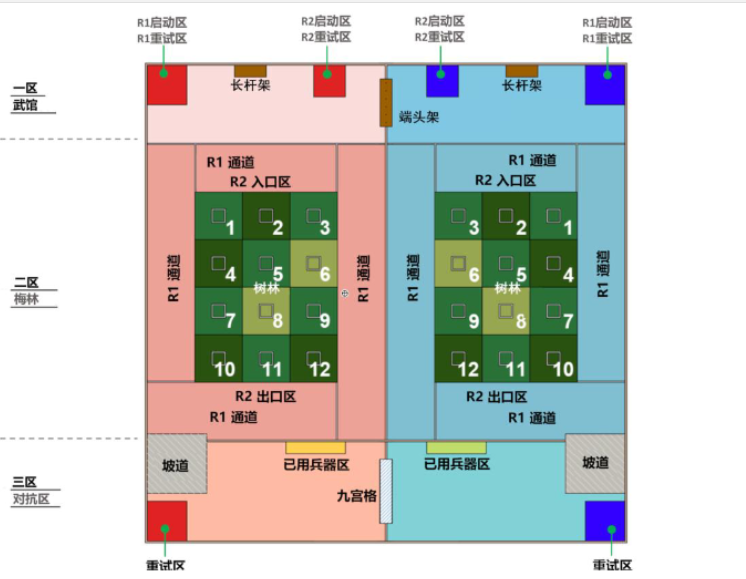
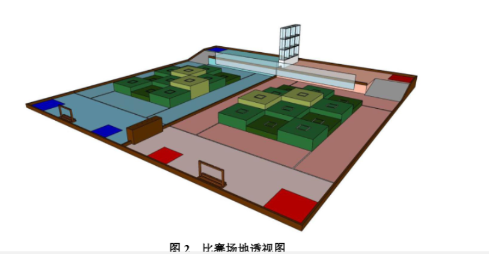
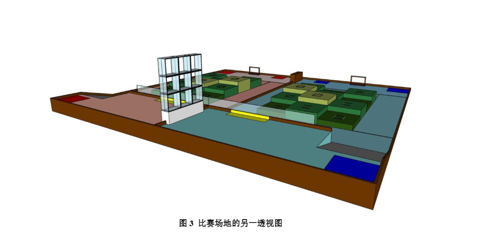
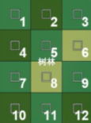
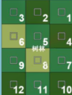
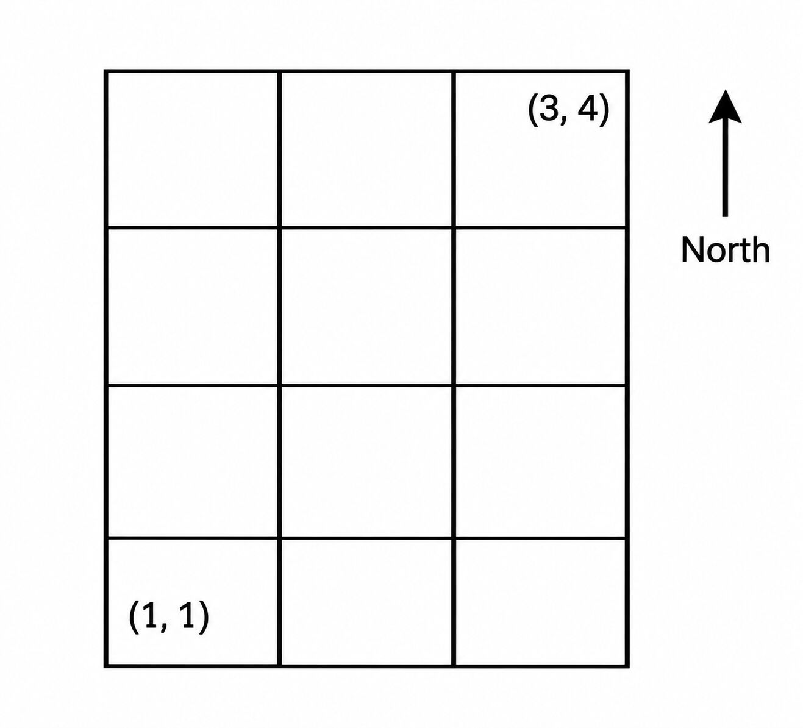
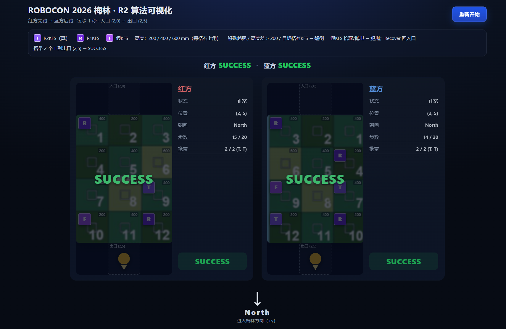
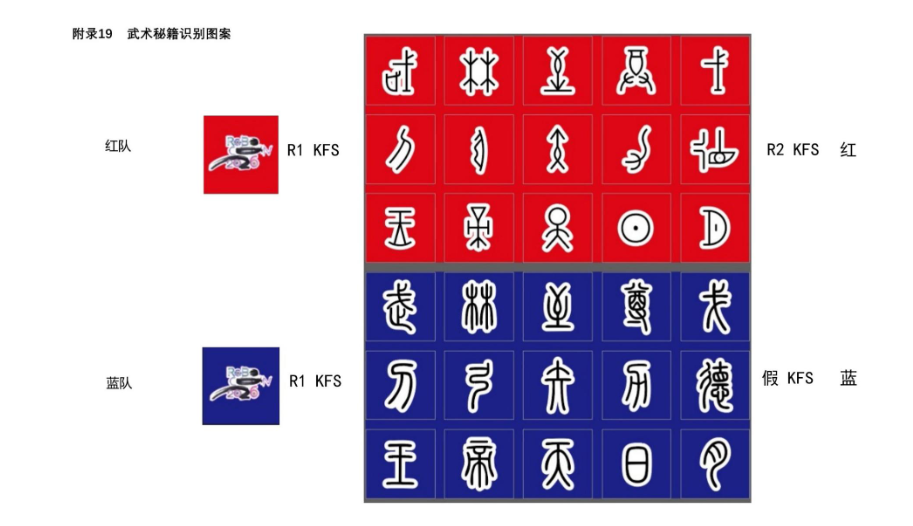
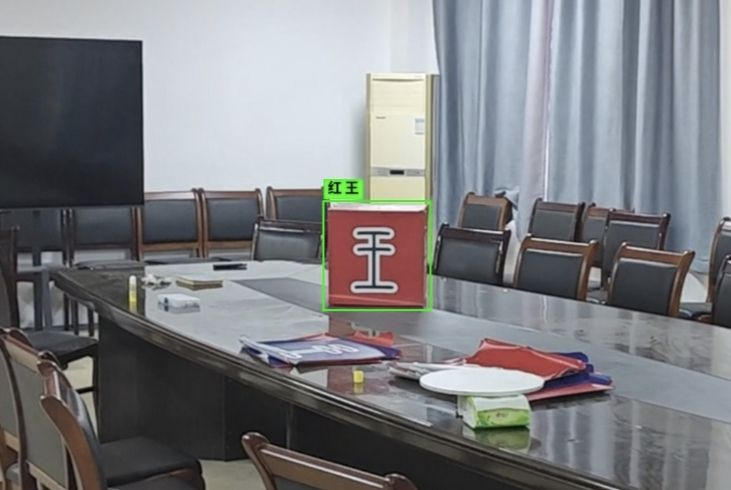
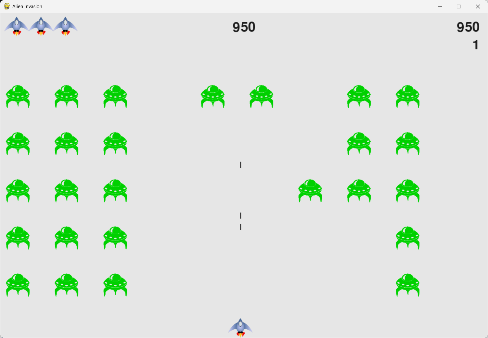

[TOC]

# ROBOCON算法组一轮考核
## 引言
> 本次考核为正式考核，分为笔试和面试。面试会在笔试结束后进行通知。截止日期为发布即日起至**12月20日晚23.59分**。投稿至邮箱<mark>mingadmirer@qq.com  
>
> 会涉及部分没有在计划清单的知识，但不会太难。同时时间也留的很长，以此来督促学习进度，落后与学习进度的同学请尽快赶上。但也不要过于急于求成，在规定时间内完成即可。会在面试后出后续的学习计划。     
>大部分题目没有明确指定win/ubuntu环境。但从长期性的角度看，推荐尽量在ubuntu下进行，以练代学。  
> 
> 使用ai学习是允许的。但是不要使用ai直接来完成任务，会在面试中提问(<mark>这很重要！！)   
> 
> 在面试时也会对你对比赛的了解进行提问，<mark>这同样很重要
## TASK 1
### 题目背景
> ROBOCON26赛季的主赛的题目主题是"武林探秘"。参赛队伍需要制造两台机器人，一台手动(R1)，一台自动(R2)。其中**自动机器人**(R2)需要通过**梅林** (有起伏的阶梯状地形)。R2必须通过梅林并收集梅林上的正确**武林秘籍**(英文简称为KFS,后文以此简称)。本题目基于此，你需要编写R2通过梅林的算法。   

[主赛规则](https://www.robocon.org.cn/sys-nd/86.html)    
[图册](https://www.robocon.org.cn/sys-nd/74.html)  
### 详细题目
比赛场地示意
  
比赛场地透视图


可以看到梅林高度分三级，最低级高度为200mm，中级高度为400mm，最高级高度为600mm。  
在方块上会随机摆放KFS，共8个，其中4个R2KFS，3个R1KFS，1个假KFS。  
KFS的摆放规则是每个方块上只能放一个KFS，其中R1KFS不能放在5号和8号位置。假KFS不能放在1号，2号，3号也就是入口的三个位置上。  
按照原有的比赛规则来讲，R2机器人是不能触碰R1KFS的。但在原有规则下R2和R1是相互配合的。为保证公平，这里新增R2可以触碰R1 KFS的规则。新增唯一出口(2，5)，只能从(2，4)抵达出口。  

---
### 行为定义
R2机器人共有以下几种action:  
**移动** ： R2机器人可以跨越高度差200mm的地形(出口和入口处不做高度差判断)，R2机器人是有朝向的，只能向朝向方向移动。R2机器人跨越地形时只能跨越无KFS的地形，否则会从正常状态变成翻倒状态(异常状态)(理论上你只能在入口和出口上下梅林，违规上下也将翻倒)。  
**拾取** : R2机器人可以在面向有R2KFS的方块且距离仅为1时拾取目标方块。R2机器人的储存上限是2。  
**抛甩** ：R2机器人可以抛甩面向且距离为1的R2/R1 KFS(这在原比赛规则里也是允许的)。为避免复杂情况，默认抛甩的结果在梅林外且不影响机器人移动。  
**转向** : R2机器人可以在运作正常时在方块上进行转向。单次转向不限制角度。  
**犯规** ：R2机器人在接触到假KFS时(拾取和抛甩)会判定为犯规状态。  
**异常** : R2机器人在异常状态下(包括翻倒和异常)，需要回到初始位置。初始位置在2号外的入口 `(2,0)`。这需要你手动调用接口执行。  
**行为定义** ： R2机器人总共可以行动20次。每次调用行动后都会将已行动次数加1，无论是否返回了正确的行为。  
**你可以获取到的信息** ：
机器人的状态(NORMAL , TIPPED_OVER , FOUL )。当前所处的位置。视野朝向1单位距离内方块KFS的摆放情况。  
**success条件** ：在指定的有限步数内到达出口 `(2,5)`，并且身上携带了正确的两个R2 KFS 。  
### 提供接口
不区分红蓝。共进行两次。  
#### 坐标与入口/出口

坐标以梅林左下角格子为 `(1,1)`，`x` 向右，`y` 向梅林里增加（即图中的 North 方向）。梅林格子范围为 `x = 1..3`、`y = 1..4`。

- **入口**：2 号方块外侧，坐标 **`(2, 0)`**，初始朝向 **North**（向 +y 进入梅林）。
- **出口**：11 号方块外侧，坐标 **`(2, 5)`**。

入口和出口都在梅林格子范围之外；`observation.vision_front` 看到越界格子时为 `std::nullopt`。入口和出口都在中列，红蓝两方的入口/出口坐标相同。

红方方块编号（场地图方向）：



蓝方方块编号（场地图方向）：



方块号与坐标的对应关系（坐标表是场地图方向旋转 180° 后的结果；y=4 在上）：

```text
红方：
y=4:  12  11  10   <- 出口排
y=3:   9   8   7
y=2:   6   5   4
y=1:   3   2   1   <- 入口排

蓝方：
y=4:  10  11  12   <- 出口排
y=3:   7   8   9
y=2:   4   5   6
y=1:   1   2   3   <- 入口排
```

即红方 `1=(3,1)`、`2=(2,1)`、`3=(1,1)`、……、`11=(2,4)`、`12=(1,4)`；蓝方按 `x -> 4 - x` 镜像。

由此，KFS 的摆放限制可以写成：

- 假KFS 不能放 1/2/3 号 → 不能放在入口排 `y=1`。
- R1KFS 不能放 5/8 号 → 不能放在 `(2,2)`、`(2,3)`。



提供html可视化界面，及C++接口，你只需要编写详细算法实现。  
```cpp
//接口
namespace merlin {

enum class Direction : std::uint8_t { North, East, South, West };

enum class RobotStatus : std::uint8_t { 
    Normal, 
    TippedOver, // 翻倒
    Foul,       // 犯规（拾取/抛甩假KFS）
};

enum class KfsType : std::uint8_t {
    None,       
    R2Kfs,      
    R1Kfs,      
    FakeKfs     
};

// 动作定义
struct Action {
    // 1. 在结构体内部定义枚举类型 Type，并声明变量 type
    enum class Type : std::uint8_t { Move, Turn, Pickup, Throw, Recover } type;
    Direction direction; 
    
    // 2. 静态构造函数（使用 Type:: 来访问）
    static constexpr Action move() noexcept { 
        return {Type::Move, Direction::North}; 
    }
    static constexpr Action turn(Direction dir) noexcept { 
        return {Type::Turn, dir}; 
    }
    static constexpr Action pickup() noexcept { 
        return {Type::Pickup, Direction::North}; 
    }
    static constexpr Action throw_kfs() noexcept { 
        return {Type::Throw, Direction::North}; 
    }
    static constexpr Action recover() noexcept { 
        return {Type::Recover, Direction::North}; 
    }
};

struct CellInfo {
    std::int16_t height; // 200, 400, 600 (mm)
    KfsType kfs;
};

struct RobotState {
    std::int8_t x;
    std::int8_t y;
    Direction facing;
    RobotStatus status;
};

struct MatchStart {
    std::int8_t start_x;
    std::int8_t start_y;
    Direction start_facing;
    std::uint8_t max_actions; // 20
};

struct Observation {
    std::uint8_t actions_taken;                 // 已经消耗的行动次数
    RobotState self;                            // 自身状态（通过对比上一帧推导结果）
    std::optional<CellInfo> vision_front;       // 前方1格信息 (越界为空)
};
```
你需要编写bot.hpp文件。编译得到referee可执行文件。运行index.html文件。  
你需要提交你的bot.hpp文件以及运行视频。  
大肥鱼vibe的html页面，不赖  

## TASK2
### 题目背景
V是夜之城的一名传奇雇佣兵。这天，他正在解决一场帮派合并。废了半天力气，终于成功平息了纷乱。现在他正在清点他在这场战斗中获得的战利品。**inventory.yaml** 里是 V 已有的装备。程序启动后先打印已有装备，然后 V 在终端里逐件登记新战利品，最后全部写回同一个文件。下次运行，新战利品还在。
### 题目要求
可参考的目录
```bash
TASK2/
├── CMakeLists.txt
├── inventory.yaml
├── equipment.h
├── weapon.h
├── cyberware.h
└── main.cpp
```
可参考的交互效果
```bash
 V 当前装备（3 件）
[Weapon] 热能武士刀 damage=150
[Cyberware] 螳螂刀 armor=25
[Cyberware] 克伦齐科夫 armor=10

战利品：w=武器 c=义体 q=保存退出
> w
  名称: 单分子线
  伤害: 200
已加入：[Weapon] 单分子线 damage=200

战利品：w=武器 c=义体 q=保存退出
> c
  名称: 副心脏
  护甲: 15
已加入：[Cyberware] 副心脏 armor=15

战利品：w=武器 c=义体 q=保存退出
> q

已保存到 inventory.yaml（共 5 件）
```

考察简单的oop。你需要编写基类和两个派生类。  
学习读取yaml文件。安装第三方库。  
你可以自己再添加简单的功能。  
### 提交要求
提交你的代码文件和试运行结果。  
## TASK3
### 题目背景
小睦最近正在学习视觉的相关内容。她了解到yolo在视觉方面处理复杂情况下的目标场景有非常广泛的应用。她查询了yolo的官网，发现最新的yolo版本是yolo26，于是她想要自己简单尝试训练部署一下。   
### 题目要求
部署最新的yolo模型，训练自己的样本集，并测试识别效果。  
学习使用conda管理python环境。  
学习模型权重文件的各种转换形式。原生训练得到的应该是.pt形式。尝试转换为.onnx格式，并运行。你也当然可以在这个过程中了解在其他不同嵌入式计算平台上的yolo的权重文件形式。    
(可提供的点子：比如找一段死神vs火影的游戏对战视频？)  
### 提交方式
运行视频。
## TASK4
### 题目背景
小乐正在参加第二十五届全国大学生机器人大赛。小乐司职算法组视觉方面，今年的主赛题目要求R2机器人能够动态识别己方KFS上的图案。  

图片示例为真的红方KFS和假的蓝方KFS。上下方文字含义相同，上方为甲骨文，下方为小篆，依次为**武林至尊戈刀弓矢力德王帝天日月**。
### 题目要求
提供三段视频，包含三种形式的KFS。你需要使用**python-opencv**对视频中的逐帧图片进行形态学处理，划分大致ROI后使用模板匹配识别具体是什么字符。当然，识别出的结果应该在原有的视频上使用矩形框框选显示。也需要在终端中进行显示，同时终端里也应该显示出检测目标的对应坐标。(0~1归一化后的坐标)  

### 提交方式
代码和实际运行视频。  
## TASK5
本题取自书籍**Python编程:从入门到实践**第十二章到第十四章的一个小项目**外星人入侵**。

### 题目要求
环境：
- Python 3.9 及以上
- pygame 2.5 及以上
- 不得引入 pygame 以外的第三方库
- 游戏必须仍能通过 `python alien_invasion.py` 启动
原题目的文件目录
```bash
+---alien_invasion
|   |   alien.py  # 初始化外星人
|   |   alien_invasion.py # 游戏的主程序
|   |   bullet.py # 子弹类
|   |   button.py # 按键类
|   |   game_stats.py # 游戏状态类
|   |   scoreboard.py # 统计信息类
|   |   settings.py # 静态的游戏设置
|   |   ship.py # 飞船类
|   |   
|   +---images  # 游戏图片素材
|   |       alien.bmp
|   |       ship.bmp
|   |       
```
这显然已经是一个相当完整的项目。现在在原项目的基础上增加以下要求:  
#### test1
**功能要求**    
在游戏进行中按 `P` 键暂停，再按 `P` 键继续。    
1. 只有游戏处于进行中时，`P` 键才有效；开始界面和游戏结束界面按 `P` 无效果。  
2. 暂停期间：   
   - 飞船、子弹、外星人全部静止；  
   - 不能移动飞船、不能发射子弹；  
   - 不产生得分，不触发碰撞，不推进任何限时效果；  
   - 除 `P`（继续）和 `Q`（退出）外，忽略其他键盘输入。  
3. 屏幕中央显示大号文字 `PAUSED`，并在其下方显示 `Press P to Resume`。文字下方需要有不透明背景，保证能看清。  
4. 恢复后游戏从暂停时的状态继续，飞船、子弹、外星人不得出现位置跳变。  
5. 游戏结束并重新开始后，必须处于“未暂停”状态。  
#### test2  
**功能要求**    
当前最高分只保存在内存中，关闭程序就会丢失。请把它保存到文件中。  
1. 在项目根目录（与 `alien_invasion.py` 同级）使用 `high_score.json` 保存最高分，格式为：

   ```json
   {"high_score": 1250}
   ```
2. 程序启动时读取该文件，并把读到的值用于记分牌显示。  
3. 每次刷新最高分后立即写回文件；即使玩家直接按 `Q` 或关闭窗口退出，最高分也不能丢失。
4. 文件不存在、内容为空、不是合法 JSON、字段缺失、类型不是非负整数时，一律按 `0` 处理，程序不得崩溃；下一次破纪录时正常覆盖该文件。
5. 重新开始游戏时最高分保留，不得被清零  
## TASK6
### 题目要求
小天正在参加机器人比赛。题目要求机器人可以在不使用外部设备连接的情况下自启动。小天已经写好了所有相关的代码。现在最后只差完成**程序上电自启动**。    
 
- 图形页面已经关闭，理论上你只能使用终端页面来进行编辑。你可以使用vim , nano编辑器。
- 有些嵌入式设备上电后会要求用户登录，然后输入密码。尝试绕过这一步。
- 自启动的程序由你自己设计。比如一个最简ROS节点，小海龟(后面的内容，现在就可以尝试接触了)。  
- 写一个.sh脚本，监视你的开机自启动程序的运行状态。可以将这个脚本加入终端的自启动(.bashrc)。

## TASK7
在ubuntu上编译一个开源的贪吃蛇小游戏。没什么难度
## TASK8
### 题目背景
自动机器人通常需要上下位机交互。下位机负责控制有高实时性要求的运动，比如底盘、机器臂的运动。上位机则可以依赖高性能的算力，运行复杂的传感器，比如激光雷达，深度相机等，负责全局的流程任务。  
通信方式有很多种，最常见使用的是**串口通信**。  
串口通信的基本原理相当简单，相关的你应该自己去了解。
### 题目要求
- 自行设计一个**串口通信协议**。
- 写两个C++程序，一个充当下位机，一个充当上位机。
- 包含简单的握手，速度指令。你可以设置添加新的模块。
- 二进制帧协议、握手、速度指令、状态反馈。
- 全双工。
- 提供代码和运行视频。
- 可选。尝试把两个代码合并到一份代码，尝试使用**C++多线程**来进行解决。  
明显简单的串口通信在实际工作中无法看是否丢包，断线重连，超时，非法字符等种种问题，这应该怎么解决呢？  
---
## 结语
> 本套题覆盖应该还是比较全面的。题量也比较大。推荐想进算法组的同学尽力完成，最后到截止时间完不成所有也没关系，请让我们看到你的努力。另外，顺便说一句，大学是充满机遇的，也是最自由的。不要因为一件事情而否定自己。无论最后结果如何，都祝你能找到属于自己的生活方式，不后悔的、圆满的度过自己的大学生活。